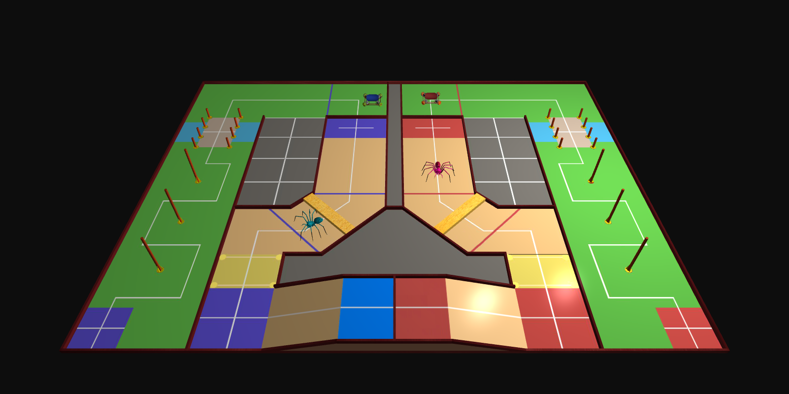
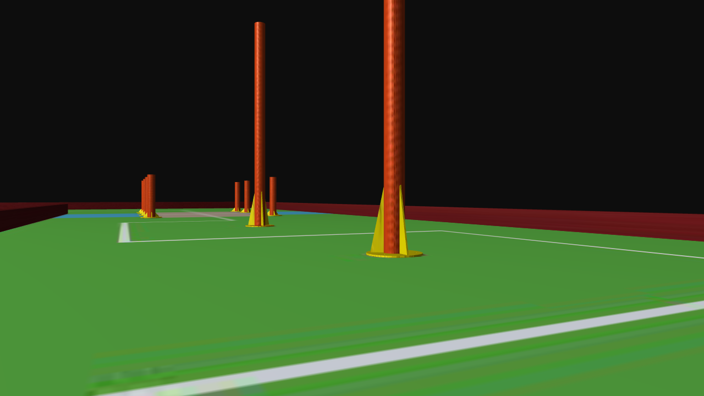
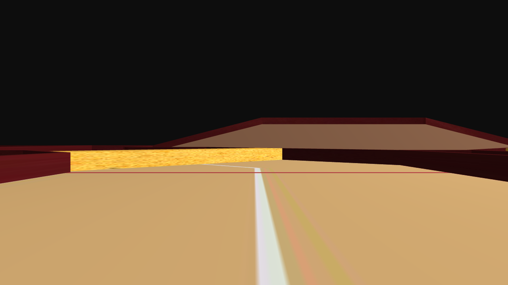
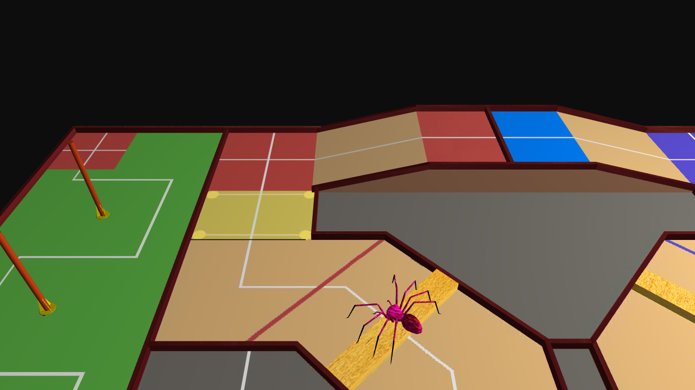
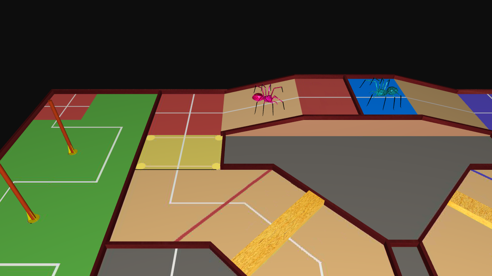
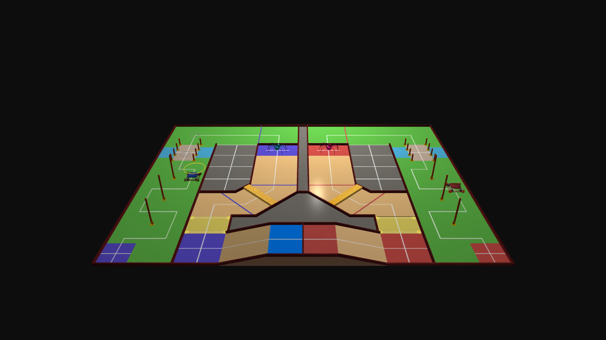
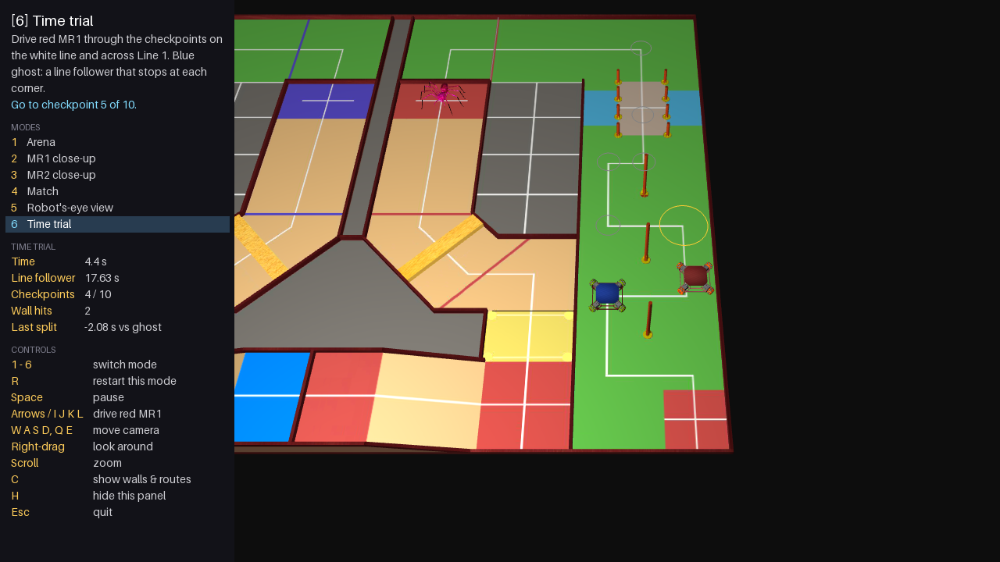
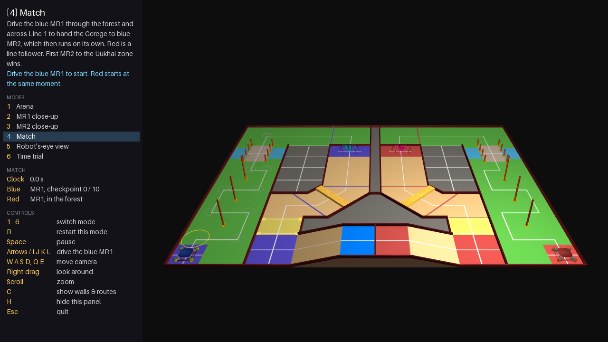
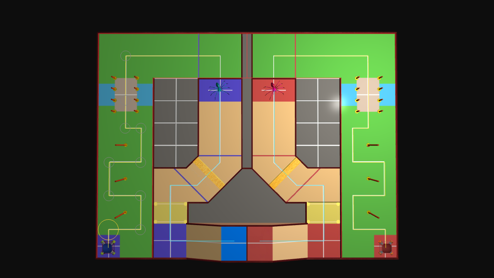

# ABU Robocon 2019 Arena

A real-time 3D visualisation of the **ABU Robocon 2019 "Great Urtuu"** arena and robots,
written in Python with OpenGL (moderngl + GLFW).



ABU Robocon 2019 was held in Ulaanbaatar, Mongolia. Its theme, *Great Urtuu*, was the
relay messenger system of the Mongol empire. Each team built a wheeled messenger robot
(**MR1**) that carries the Gerege (the messenger's token) from Khangai urtuu along the
white guideline through the forest, over the bridge and across Line 1, then hands it to a
four-legged robot (**MR2**), which carries it on over the sand dune, tussock and mountain.

The simulator renders the arena and both teams' robots from Blender models made from the
rulebook drawings. The robots follow the white guidelines laid down in the rulebook, MR2
climbs the field's sand dune and mountain, and you can drive MR1 yourself: in a match
against an automatic line-following team, or in a time trial against a ghost.

| Robot's-eye view through the forest | MR2's view after the hand-off |
|---|---|
|  |  |

## Modes

| Key | Mode | What it shows |
|---|---|---|
| 1 | Arena | The whole arena, turning slowly |
| 2 | MR1 close-up | The omni-wheel messenger robot at 10x scale |
| 3 | MR2 close-up | The legged messenger robot at 10x scale |
| 4 | Match | You drive the blue MR1 and hand over to the automatic blue MR2; red is a line follower. First MR2 to the Uukhai zone wins |
| 5 | Robot's-eye view | Ride along as MR1 through the forest, then as MR2 over the sand dune and up the mountain |
| 6 | Time trial | Drive MR1 through the course yourself against a line-following ghost; every run is logged |

Pressing a mode key again replays it from the start.

## MR2's run

| Over the sand dune | Up the mountain |
|---|---|
|  |  |

After the hand-off, MR2 follows its own white guideline through the Gobi area, as rules 1.6
and 1.8 describe: it crosses Line 2, steps over the sand-dune timber, crosses Line 3, goes
through the tussock into Mountain urtuu and waits there while MR1 throws the Shagai, then
climbs the mountain to the Uukhai zone and raises the Gerege ("UUKHAI!"). The sidebar
follows each stage. Its height comes from the arena model, so it steps up 0.1 onto the timber
and climbs the ramp to the 0.4-high top.

## Match



A race against the red team, following the rule that MR1 may be driven by hand and MR2
must be automatic:

1. **Drive the blue MR1** (arrows or `I J K L`) from Khangai urtuu along the white
   guideline, through a checkpoint on every corner and on the bridge (the amber ring marks
   the next one).
2. **Cross Line 1**, then drive into the ring in Gobi urtuu to **hand the Gerege to the blue
   MR2**.
3. **Blue MR2 runs on its own** over the sand dune, through the tussock and up the
   mountain.
4. **Red** (a line follower that stops at every corner, then its own MR2) starts at your
   first input. **The first MR2 to reach the Uukhai zone wins.**

The sidebar says what to do next and shows the clock and both teams' progress. A tidy run
hands over in about 14.5 s against red's 18.4 s and wins by about 4 s; stop driving and red
wins.

## Time trial



Drive the red MR1 from Khangai urtuu along the white guideline, through a checkpoint on
every corner and on the bridge (in order, as rule 1.4.2 requires following the
guideline), and across Line 1. The clock starts on your first input and stops when the
whole robot is past Line 1.

- **Reference time.** The blue ghost is a line follower with the same top speed (2 m/s)
  and acceleration (2 m/s²) as your robot that brakes to a stop at every corner, the way
  a simple line-following MR1 would. Its time to Line 1 is the reference (about 17.6 s).
- **Splits.** Each checkpoint shows how far ahead (−) or behind (+) the ghost you are.
  The way to beat it is to carry speed through the corners.
- **Run log.** Every finished run is appended to `~/.local/share/robocon/time_trials.csv`
  (or `$ROBOCON_DATA/time_trials.csv`) with the date, your time, the reference, the
  difference and the number of wall hits. The sidebar shows your best and recent runs.

## Running it

Needs Python 3.10+, [uv](https://docs.astral.sh/uv/) and a GPU with OpenGL 3.3
(any Mac, Windows or Linux machine from the last decade).

```bash
uv sync
uv run robocon
```

The first start parses the robot models (a few seconds) and caches them in
`~/.cache/robocon`. Later starts are quick.

A sidebar shows every mode, the current one, what it is showing and the keys that work in
it. The 3D view sits beside it, never under it. Press `H` to hide or show it.



| Input | Action |
|---|---|
| `1`-`6` | Switch mode / restart it |
| `R` | Restart the current mode |
| `Space` | Pause / resume |
| `W A S D`, `Q E` | Move the camera; down / up |
| Right-drag | Look around |
| Scroll | Zoom |
| Arrows or `I J K L` | Drive MR1: blue in the match, red in the time trial (walls stop it) |
| `C` | Show collision walls and robot routes |
| `H` | Hide / show the sidebar |
| `Esc` | Quit |

Render every mode to PNG without opening a window (this is how the screenshots above were made):

```bash
uv run robocon --capture docs/screenshots
```

Run the checks:

```bash
uv run pytest
uv run ruff check . && uv run ruff format --check .
```

## How it works

```
src/robocon/
  __main__.py    command line: window or --capture
  app.py         GLFW window and input -> Simulation -> Renderer
  simulation.py  mode switching, pause, frame-time clamp, light orbit, overlays (no OpenGL)
  modes.py       modes 1-3 and 5; each resets the scene on entry and animates from elapsed time
  match.py       mode 4: you drive blue against the red line follower, first MR2 to Uukhai wins
  trial.py       mode 6: hand driving, checkpoints, Line 1 finish, line-follower ghost
  runlog.py      time-trial results in a CSV file
  scene.py       entities (model, position, scale, yaw, visibility) as plain data
  path.py        the white guidelines as routes, and the line-follower speed profile
  mr2.py         MR2's run as a function of time: stages, waits, height and heading
  terrain.py     floor height from the arena's sand dune and mountain triangles
  collision.py   forest-lane walls and circle-vs-segment collision with sliding
  camera.py      yaw/pitch fly camera, per-frame projection
  graphics.py    moderngl renderer: one vertex array per material, texture cache, line overlay
  obj_loader.py  OBJ/MTL parser with per-material submeshes and an on-disk cache
  hud.py         sidebar: text drawn with Pillow, shown as a textured quad
  capture.py     offscreen rendering with 4x MSAA for screenshots and tests
  shaders/       Blinn-Phong, debug-line and help-panel GLSL
```

- **Rendering.** Each model is split per material and uploaded as flat vertex buffers
  (position, normal, UV). The fragment shader is Blinn-Phong with one orbiting point
  light. Textured parts sample their texture, and untextured parts use their material colour.
- **Animation.** Everything is a function of elapsed time, so it runs at the same speed
  at 30 fps or 144 fps. Simulation, scene, routes and collision do not depend on OpenGL,
  which is why most of the code is unit tested.
- **Routes.** MR1's route is the white guideline itself, measured from the floor texture
  (the floor maps the texture as `x = 13.40 u − 6.70`, `z = 5.05 − 10.10 v`): square
  corners around the three forest poles, straight over the bridge, along the top lane
  across Line 1 to Gobi urtuu. It is a polyline sampled by distance, shared by the match,
  the robot's-eye camera and the time trial, and mirrored for the blue side.
- **MR2 and terrain.** MR2's guideline was measured the same way. Lines 2 and 3 (the red
  lines) and the tussock and Mountain urtuu zones mark its stages. Height is the highest
  raised triangle under the robot, from the model's sand-dune and mountain materials.
- **Line follower.** On each straight the robot accelerates, cruises and brakes to a stop
  before the corner (a trapezoidal speed profile, solved analytically with its inverse so
  split times are exact).
- **Collision.** The walls of the forest lane are line segments. A robot is a circle tested
  against them; a blocked move slides along the wall.



## What is missing

Parts of the real game that are not modelled:

- **Game objects.** The Gerege (the message token handed from MR1 to MR2) and the Shagai
  are not modelled. MR2 waits a fixed 3 s at Mountain urtuu in place of MR1's Shagai throws.
- **Tussock ropes.** The tussock exists only in the floor texture (its rope posts are painted
  on), so MR2 walks through it without stepping over ropes.
- **Moving parts.** MR2's legs are one rigid mesh, so it glides and turns instead of
  stepping, and it stays level on the mountain ramp; MR1's omni wheels do not turn.
- **Collision covers only the forest lane.** The other fences, the bridge and the
  mountain are not collision objects, and the robots do not collide with each other.
- **No rulebook scoring.** The match is decided by the first MR2 to reach the Uukhai zone
  (the knockout win); the points for crossing Lines 1-3 and for the Shagai are not counted.
  Both the match and the time trial check the course with checkpoints rather than
  penalising every moment off the line.
- **One human player.** You always drive the blue MR1 in the match and the red one in the
  time trial; there is no two-player mode.
- **Lighting is basic.** One point light, no shadows, no gamma correction.

## Ideas for what to add next

1. **Shagai and Gerege.** Model the hand-off, MR1's Shagai throws into the landing zone (rule 1.7) and MR2 raising the Gerege, instead of the fixed wait.
2. **Leg and wheel animation.** Separate MR2's legs in Blender and drive them with a procedural gait; spin MR1's omni wheels from its velocity.
3. **Replay real robot logs.** Load odometry recorded on a real robot (CSV or a ROS bag) and play it back on the arena, next to the planned route.
4. **Path planning.** Let MR1 plan its own fastest legal line through the checkpoints (for example a time-optimal path with the same acceleration limits) and compare it with the line follower and your best run.
5. **Time-trial extras.** Replay your best run as a second ghost, gamepad support, a timed MR2 stage, and a penalty for leaving the guideline.
6. **Rulebook scoring and two players.** Points for Lines 1-3, the hand-off and the Shagai, a 3-minute match clock, and a second player driving red.
7. **Better rendering.** Shadow mapping, gamma-correct lighting, a skybox.
8. **An in-app panel** (Dear ImGui) for scrubbing the timeline and tuning lights.
9. **A web version** with WebGL (for example three.js or pygbag) so the project can be viewed in a browser.

## Credits

- **3D models:** Sajil Awale ([@AwaleSajil](https://github.com/AwaleSajil)), modelled in Blender.

The floor and mountain textures come from the official ABU Robocon 2019 rulebook drawings.
See [assets/CREDITS.md](assets/CREDITS.md).
